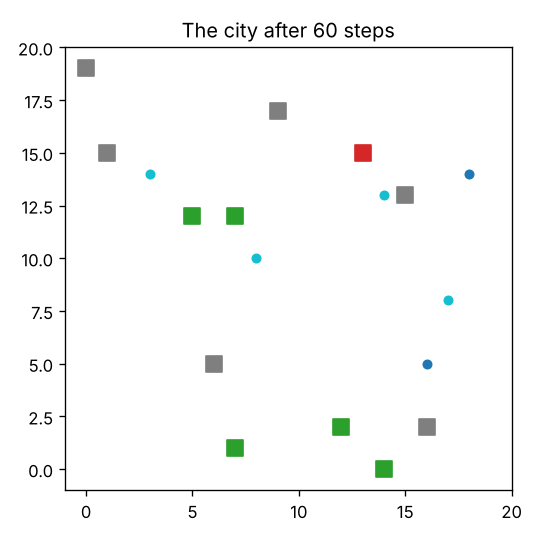
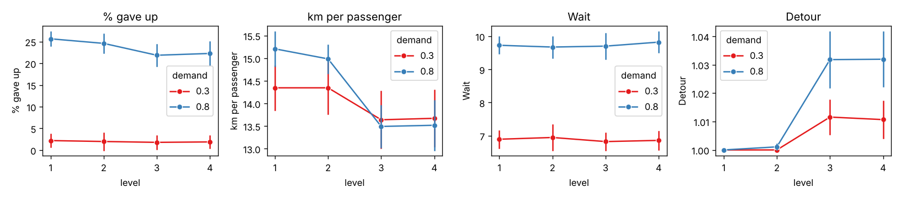

# Multi-Agent Simulation: Urban Mobility Policy

Would shared taxis cut the kilometres driven in a city, and what would passengers
pay for it in waiting time and detours? We answer with an **agent-based simulation
in Python (Mesa)**, where taxis and passengers are autonomous agents that negotiate
rides by exchanging messages.

> Course project for **Foundations of Agent-based Systems**, Université Paris-Saclay.

<p>
  
  
  
  
  
</p>

---

## At a glance

| | |
| --- | --- |
| **Question** | A city council wants to test shared taxis to reduce pollution. What changes for traffic, travel time and passenger acceptance? |
| **Approach** | A 20×20 km city with 12 taxis and random passengers. Taxis and passengers are agents that negotiate each ride with the **Contract Net Protocol** (call for proposals → offers → accept/reject). Four design levels, from today's taxi to 4-seat shared taxis. |
| **Experiments** | Every setting run 10 times with fixed seeds; demand, fleet size, accepted detour, seats, passenger patience and a safety margin varied one at a time. |
| **Main result** | With the same fleet, sharing needs **7–11% fewer km per passenger** and leaves fewer people without a taxi, for rides only **3% longer** on average. With a large fleet it gives **the same service with 11% fewer km**. |
| **Skills** | Agent-based modelling, simulation design, object-oriented Python, experiment design with seeds and paired comparisons, data analysis with pandas, visualisation, automated invariant checks. |

<p align="center">
  
  <br>
  <sub>The city after 60 steps. Squares are taxis (grey: empty, green: 1 passenger, red: 2 or more); dots are passengers (blue: calling, cyan: booked).</sub>
</p>

---

## How the model works

**The city.** A 20×20 grid where one cell is one district (1 km). A taxi crosses one
district per step. New passengers appear at random with a destination at least 2 km away.

**Two kinds of agents**, both running a *perceive → decide → act* loop with one action per step:

- **Passenger**: calls all taxis, picks the offer that gets it to its destination first,
  and gives up if nobody books it within `max_wait` steps. It states two limits:
  the longest ride it accepts and the latest time it wants to arrive.
- **Taxi**: plans its route as a list of stops. To take a new passenger it tries every
  place to insert the pickup and drop-off, and keeps the shortest route that respects
  the seats and the limits of every passenger already on board.

**Negotiation by messages** (Contract Net Protocol, FIPA):

```
Passenger ──cfp (trip, limits)──────────▶ all taxis
Passenger ◀──propose (arrival time)────── taxis that can take it
Passenger ──accept-proposal─────────────▶ best taxi
Passenger ──reject-proposal─────────────▶ the others
Passenger ◀──inform / inform-done──────── taxi (pickup, arrival)
```

**Four design levels**

| Level | Seats | A taxi that already has passengers takes a new one if... |
| --- | --- | --- |
| 1 | 1 | never (today's taxi) |
| 2 | 2 | its route does not get longer |
| 3 | 2 | every passenger keeps its limits (accepted detour, latest arrival) |
| 4 | 4 | same as level 3, with more seats |

---

## What we found



- **Level 3 is the real step.** At high demand, moving from today's taxi (level 1) to
  sharing with route changes (level 3) cuts km per passenger by **11%** (15.2 → 13.5)
  and the share of passengers left without a taxi from 25.7% to 21.9%. Level 3 beats
  level 2 in **10 out of 10 runs**.
- **Two seats are enough.** With reasonable passenger limits a third or fourth passenger
  almost never fits, so levels 3 and 4 give the same numbers.
- **The accepted detour is the key policy choice.** From 0 to 8 km of accepted detour,
  shared rides go from 6% to 54% and people left without a taxi from 28% to 17%, but
  waits get longer. It is a trade-off between service and comfort, and the council has to choose.
- **Promises need a margin.** Without slack, 22% of shared passengers arrive late,
  because sending messages costs taxis time. A margin of one step per stop brings this to
  about 1%, and sharing still saves 7% of km per passenger.

| Same fleet (16 taxis, high demand) | Served | % gave up | Total km | km / passenger |
| --- | ---: | ---: | ---: | ---: |
| Level 1: today's taxi | 222.5 | 7.9 | 3,330 | 14.97 |
| Level 4: shared taxi | 222.6 | 7.9 | **2,974** | **13.36** |

The full analysis, the limits of the model and every chart are in
**[`report.pdf`](report.pdf)** (10 pages). All the numbers are in
[`results/tables.txt`](results/tables.txt).

---

## Repository layout

```
├── taxi_share/
│   ├── messages.py      Message and MessageReceiver: direct communication between agents
│   ├── agents.py        Passenger and Taxi: perceive → decide → act, route planning
│   └── model.py         TaxiModel: the city grid, message delivery, new passengers, measures
├── app.py               live dashboard with sliders and charts (Solara)
├── experiments.py       all the experiments of the report (~1 minute)
├── checks.py            automated checks that the code follows the model (~10 seconds)
├── results/             tables and charts produced by experiments.py
└── report.pdf           the full report
```

---

## Run it

```bash
python -m venv .venv && source .venv/bin/activate
pip install -r requirements.txt

solara run app.py        # live view: the city, sliders for every parameter, charts
python experiments.py    # reproduces every table and chart in results/
python checks.py         # verifies the rules of the model at every step
```

`checks.py` asserts, at every step of 24 simulations, that each agent does at most one
action, that no taxi has more passengers than seats, that no ride is longer than its
passenger accepts, and that every passenger eventually leaves the city.

---

## Authors

- Ludovica de Martino
- Claudio Bendinelli
